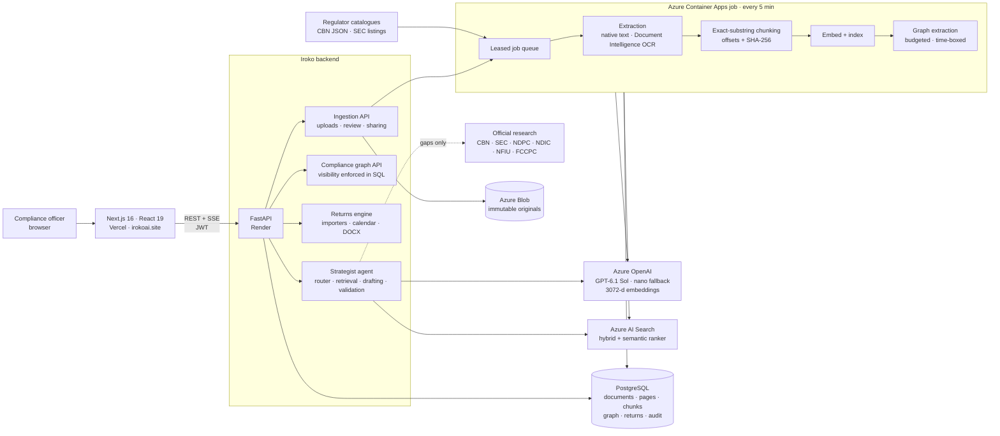
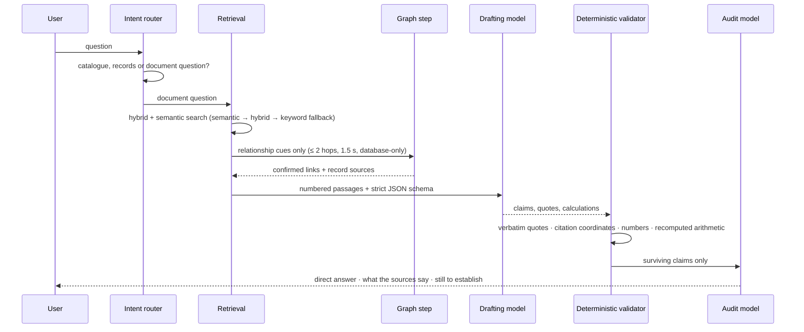
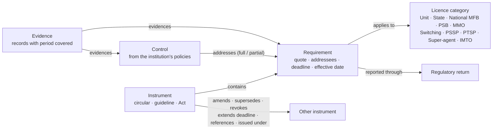

<div align="center">

# 🌳 Iroko AI

### Regulatory intelligence for Nigerian microfinance banks and fintechs

**Ask the rulebook. Map your controls. File your returns. Prove it to the examiner.**

[](https://www.python.org)
[](https://fastapi.tiangolo.com)
[](https://nextjs.org)
[](https://react.dev)
[](https://azure.microsoft.com/products/ai-services/openai-service)
[](https://azure.microsoft.com/products/ai-services/ai-search)
[](https://www.postgresql.org)
[](#quality-and-evaluation)

[Live platform](https://irokoai.site) · [Architecture](#architecture) · [How an answer is made](#how-an-answer-is-made) · [Compliance knowledge graph](#the-compliance-knowledge-graph) · [Run it locally](#run-it-locally)

</div>

---

Nigerian financial institutions answer to a crowded rulebook: CBN circulars, guidelines and frameworks, the BOFIA, the
Money Laundering (Prevention and Prohibition) Act, NDPA 2023 and its GAID, NFIU, NDIC, FCCPC and SEC instruments. Much of it is
published as scanned PDFs, amended by later letters, and addressed to some licence categories but not others. Compliance teams
read it by hand, map it to their policies in spreadsheets, and rebuild the evidence trail before every examination.

**Iroko turns that rulebook into a system.** Every answer quotes the regulation word for word, with the page it came from. Every
requirement is linked to the licence categories it binds, the institution's own controls, and the evidence that those controls
run. When a regulator amends, supersedes or revokes something, Iroko shows which controls need another look.

## What Iroko does

| | Capability | What makes it different |
|---|---|---|
| 💬 | **Cited compliance answers** | Every quote is verified verbatim against the source passage before display; figures must come from a cited passage or a calculation Iroko recomputes in code. Gaps are stated, never guessed: *"not established in Iroko's records."* |
| ⚖️ | **GO / MONITOR / NO-GO compliance check** | Verdicts are grounded in quoted rules; anything unverified is MONITOR, and "nothing found" can never become GO. Revoked, superseded, amended and not-yet-in-force instruments adjust the verdict. |
| 🕸️ | **Compliance knowledge graph** | Requirements extracted from regulations with exact quotes, addressees, deadlines and effective dates; relationships between instruments; the institution's controls and evidence mapped to every requirement, with per-licence applicability and coverage. |
| 🔔 | **Regulatory change tracking** | New versions, amendments, revocations and deadline extensions raise impacts on exactly the controls they touch, flag them for re-review and open tasks. |
| 📑 | **Regulatory returns assistant** | Ten MFB returns pre-filled from the institution's profile, past filings, documents and raw core-banking exports. Every figure carries its source, and an officer confirms every value. |
| 📚 | **Regulator library with provenance** | 90+ official instruments, each with its source URL, how it was acquired and checksum verification; page-accurate OCR, hybrid search and versioning. |
| 🌐 | **Live official research** | When the library lacks an answer, Iroko reads the regulators' own websites. Only public regulatory vocabulary reaches the search engine, never names, figures or customer details. |
| 🧾 | **Audit-ready by construction** | One-click audit pack (.xlsx), append-only review history and a SHA-256 hash-chained audit trail. |

## Architecture



The API never calls a model while holding a database lock, and graph queries at answer time touch only the database. A model,
search or web outage therefore degrades features one at a time instead of taking the product down.

## How an answer is made



- **The model never writes a quote.** It cites a passage and a span, and the validator accepts the span only if it is a contiguous,
  verbatim substring of that passage. Near-exact misquotes are realigned to the true text, and the right words cited to the wrong
  passage are re-attributed only on an exact match. Ellipsis-joined quotes are always rejected, because elided words can hide a qualifier.
- **Numbers are evidence too.** A claim may contain only figures found in its cited passages or produced by a checked calculation.
  Arithmetic is recomputed with `Decimal` in code, never trusted from the model.
- **An audit pass re-checks the survivors** against the evidence before anything is rendered.
- **When the library falls short**, bounded research fetches official regulator pages: at most three regulators and two documents each
  within 28 seconds. Search results are pointers, never evidence. Text is used only after Iroko has fetched it from an approved
  domain. A CBN PDF behind a bot check is read from an Internet Archive capture of the same official URL **only when its bytes match
  CBN's catalogue size exactly**; bot checks are never bypassed.

Reference: [docs/chat-request-flow.md](docs/chat-request-flow.md) · [docs/chat-decision-policy.md](docs/chat-decision-policy.md)

## The document pipeline

| Stage | What happens |
|---|---|
| **Accept** | Content-type and size validation, workspace quotas, SHA-256 of the original, immutable write to Blob (`<document>/<file>`, never overwritten) |
| **Extract** | Native PDF/DOCX/XLSX text where it exists; Azure Document Intelligence OCR for scanned pages, metered by a daily page budget; per-page quality metrics |
| **Review gates** | Missing publication date, near-empty pages or pending OCR hold a document for human review instead of indexing it silently |
| **Chunk** | Exact substrings of the joined page text (600-token target, 1,000 max, 60 overlap) carrying `char_start`/`char_end`, page range, section heading and a content hash, so every citation resolves to a precise location |
| **Index** | 3072-dimension embeddings and hybrid documents in Azure AI Search, keyed `<document>_chunk_<n>` |
| **Version** | `source_key` lineage links each revision to its predecessor, and a new version of a shared regulation stays private until a superadmin publishes it |
| **Queue** | Postgres-backed jobs with leases, 30-second heartbeats, retries, and `defer()` for budget exhaustion, time-boxing and outages without spending attempts |

Imports keep **provenance** on every document: official download, browser download, or exact-size archive capture, plus what the
file was verified against. Curated imports run with `python -m ingestion import-manifest` or `import-folder`.
Operations: [docs/ingestion/OPERATIONS.md](docs/ingestion/OPERATIONS.md)

## The compliance knowledge graph



- **Three states for every relationship.** Basis is *stated in source*, *suggested by Iroko* or *entered by a person*. Review
  status is *proposed*, *confirmed*, *rejected* or *needs re-review*. Suggestions are never auto-confirmed. There are no
  confidence scores, only quotes and a named reviewer.
- **"Stated" is earned.** It needs a performative cue bound to its target in the same clause ("hereby revokes…") and a unique,
  deterministic target match. Licence revocations that mention an Act, "(as amended)" and shared reference numbers are
  covered by trap cases in the evaluation set.
- **Addressees from the instrument's own words.** Exact header matches are stated. Typo-tolerant matches, generic terms and a title
  that narrows a group header ("all OFIs" + "…for Finance Companies") are suggestions for a reviewer.
- **Stable identity across versions.** Requirements keep a `lineage_id` through exact and fuzzy matching (same section, ±15 %
  position), so owners, applicability decisions and confirmations survive new versions, and changed text raises an impact.
- **Coverage is computed, never stored as a verdict.** A requirement can be *no control linked*, *control confirmed, no evidence*,
  *evidence out of date* or *needs re-review*. A gap reads *"Not established in Iroko's records"*, never "non-compliant".
- **Tenancy in SQL.** Library rows are visible only when all their documents are visible to the caller. Private documents from two
  workspaces are never linked, and leak tests cover pages, counts, search, the explorer, exports and chat.
- **Split review.** Iroko superadmins confirm shared regulation facts; each institution's admins confirm its own controls, evidence and
  applicability decisions.
- **Cost control.** Daily token budgets (global and per workspace), a per-minute pacer to protect chat's quota, a judgement cache so
  unchanged pairs are never re-judged, and stage checkpoints with a 150-second time box per claim.

UI: Overview · Requirements · Controls · Explorer (instruments → requirements → controls → evidence) · Review · Changes, an Evidence
panel with both sides' quotes and history, and an audit-pack export. Runbook: [docs/compliance-graph.md](docs/compliance-graph.md)

## Regulatory returns assistant

| Return | Regulator |
|---|---|
| Monthly prudential returns (MMFBR 300/1000 and schedules) | CBN |
| Frauds and forgeries · Corporate governance compliance · Whistle-blowing compliance | CBN |
| Audited financial statements submission · Board and directors' appraisal | CBN |
| Suspicious transaction report · Currency transaction report | NFIU |
| Certified deposit liabilities (premium assessment) | NDIC |
| Annual data protection compliance audit return | NDPC |

- **Reads the files a bank already produces.** Trial balance, loan book and cash transactions are read in whatever layout the core
  banking system exports. Columns are found by header synonyms; if one is still missing, the model picks from the real headers, and
  the officer can override.
- **Learns the chart of accounts.** GL accounts map to MMFBR lines from the institution's own earlier mappings first, then
  accounting rules, then the model. Corrections are remembered, so next month maps without help, and an unmapped account is never
  guessed silently.
- **Every amount comes from a file.** The model only classifies labels it is shown. Prudential computations and minimum-capital
  checks run per licence category, due dates follow each return's rule on Lagos working days, and filings are generated as Word documents.

## Trust and safety principles

1. **No invented quotes, figures or penalties.** Everything shown is checked against a source or recomputed.
2. **Absence is not compliance.** Missing evidence produces MONITOR or a stated gap, never GO.
3. **People decide.** Suggestions, mappings and returns values need a named human confirmation, and every decision carries a note and an audit event.
4. **Read-gate, never delete.** Archived, rejected or unshared material leaves current views but stays in history.
5. **Customer data stays inside Iroko.** Searches carry only public regulatory vocabulary, and downloaded web text is treated as data, never as instructions.
6. **Degrade, don't fail.** Semantic-ranker quotas fall back to hybrid, then keyword, search. Model outages switch chat to a fallback model, while background extraction defers rather than downgrading.

## Quality and evaluation

Iroko is measured with isolated evaluation harnesses (SQLite copies, never production writes) and error analysis. Fixes target
the system, not the model.

| Suite | Result | Date |
|---|---|---|
| Graded CBN document questions (28, production model) | 26/28 on the full run; both failures fixed and passing on re-test | Oct 2026 |
| Multi-turn conversation scenarios | 24/24 | Oct 2026 |
| Retrieval: right passage in top 12 · right document first | 100 % · 97 % | Oct 2026 |
| Graph extraction: deterministic checks · model checks · traps | 125/125 · 44/44 (100 % recall) · 8/8 | Oct 2026 |
| Control-to-requirement mapping · graph chat scenarios | 18/18 · 6/6 | Oct 2026 |
| Backend unit and integration tests | 1,311 tests across 52 files | Oct 2026 |

Method and tooling: [docs/ai-quality-playbook.md](docs/ai-quality-playbook.md) · `scripts/evaluate_document_answers.py --model sol` ·
`scripts/evaluate_graph_extraction.py` · `scripts/evaluate_conversations.py` · `scripts/build_review_viewer.py`

## Technology

| Layer | Technology |
|---|---|
| Frontend | Next.js 16 (App Router), React 19, TypeScript, Tailwind CSS 4, TanStack Query 5, server-sent events, on Vercel |
| API | FastAPI 0.115, Pydantic, SQLAlchemy 2, JWT auth, role-based access (superadmin · admin · analyst · viewer), on Render |
| Data | PostgreSQL (application schema plus an Alembic-managed `ingestion` schema), Azure Blob Storage |
| AI | Azure OpenAI Responses API (GPT-6.1 Sol) with Chat Completions fallback (gpt-5.4-nano), strict JSON-schema outputs, 3072-d embeddings |
| Search | Azure AI Search, hybrid vector + BM25 with semantic ranker, plus a pure-Python BM25 for graph candidate ranking |
| Documents | Azure AI Document Intelligence (OCR), pdfplumber, openpyxl, tiktoken |
| Background | Azure Container Apps scheduled job (Bicep in `backend/deploy/`), Postgres-backed leased queue |
| Research | Official regulator clients (robots.txt-aware, domain allowlist, size limits), Bright Data SERP for discovery |

## Repository layout

```
backend/
  agents/                 strategist (chat orchestration), kernel (model calls, fallback)
  services/
    grounded_answers.py   drafting schema, verbatim-quote and number validation, rendering
    chat_router.py        intent routing (catalogue · records · documents · shorthand)
    azure_search.py       hybrid/semantic retrieval with graded fallback
    regulatory_research.py, regulatory_discovery.py   bounded official research
    compliance_graph/     taxonomy, segment, relations, deadlines, lineage, mapping, sync, review, queries, export
    regulatory_returns/   catalogue, importers, prudential, calendar, drafts, docx
  ingestion/              accept → extract → chunk → index pipeline, queue, worker, crawlers, manifests, CLI
  routes/                 REST API (chat, documents, compliance graph, returns, workflows, audit, users)
  models/                 SQLAlchemy models (application, compliance graph, filing, workflow, audit trail)
  scripts/                evaluation harnesses and review tooling
  tests/                  1,311 tests: ingestion, compliance_graph, regulatory_returns, llm, chat
  deploy/                 Azure Container Apps job (Bicep)
frontend/
  app/(app)/              chat, documents, knowledge-graph, compliance (check · returns · reports), workflows, audit-trail
  components/, lib/       UI kit, typed API hooks, chat presentation
docs/                     architecture, runbooks, evaluation reports
```

## Run it locally

**Prerequisites:** Python 3.13, Node.js 20+, PostgreSQL (or SQLite for tests), and Azure OpenAI, AI Search, Blob and
Document Intelligence resources.

```bash
# Backend API
cd backend
python -m venv .venv && .venv/Scripts/activate    # source .venv/bin/activate on macOS/Linux
pip install -r requirements.txt
uvicorn main:app --reload --port 8000             # OpenAPI docs at http://localhost:8000/docs

# Document worker (needs DOCUMENT_PIPELINE_ENABLED=true on both API and worker)
python -m ingestion worker

# Frontend
cd ../frontend
npm install
npm run dev                                       # http://localhost:3000
```

Configuration uses environment variables. Names only; keep values out of the repository:

```
DATABASE_URL  SECRET_KEY
AZURE_OPENAI_ENDPOINT  AZURE_OPENAI_API_KEY  AZURE_OPENAI_DEPLOYMENT  AZURE_OPENAI_NANO_DEPLOYMENT
AZURE_OPENAI_RESPONSES_ENDPOINT  AZURE_OPENAI_RESPONSES_API_KEY  AZURE_OPENAI_RESPONSES_DEPLOYMENT
AZURE_SEARCH_ENDPOINT  AZURE_SEARCH_API_KEY  AZURE_SEARCH_INDEX_NAME
AZURE_STORAGE_CONNECTION_STRING  AZURE_STORAGE_CONTAINER
AZURE_DOCUMENT_INTELLIGENCE_ENDPOINT  AZURE_DOCUMENT_INTELLIGENCE_KEY  DOCINTEL_DAILY_PAGE_BUDGET
DOCUMENT_PIPELINE_ENABLED  COMPLIANCE_GRAPH_ENABLED
GRAPH_DAILY_TOKEN_BUDGET  GRAPH_WORKSPACE_DAILY_TOKEN_BUDGET  GRAPH_TOKENS_PER_MINUTE
BRIGHTDATA_API_KEY  BRIGHTDATA_SERP_ZONE  BRIGHTDATA_REGULATORY_SEARCH_ENABLED
```

**Tests** run against an isolated SQLite file and never load `backend/.env`:

```bash
cd backend
IROKO_LOAD_DOTENV=false DATABASE_URL=sqlite:///iroko_test.db python -m pytest tests -q
cd ../frontend && node --test tests/ && npx tsc --noEmit
```

**Ingestion CLI:** `python -m ingestion {worker|once|drain|scheduled-drain|stats|check|import-manifest|import-folder|graph-backfill}`.
`graph-backfill` refuses to queue work in a non-SQLite database unless `--production` is passed explicitly.

## Deployment

| Component | Where | How |
|---|---|---|
| Frontend | Vercel (`irokoai.site`) | Builds from `main` |
| API | Render | Auto-deploys on push to `main`; configuration in Render environment variables |
| Worker | Azure Container Apps job | `az acr build --file Dockerfile.ingestion-job` from a clean checkout, then update the job image |
| Health | `GET /health/full` | Database, search, both models, embeddings, blob and web intelligence, with latencies |

## Documentation

| Topic | Document |
|---|---|
| Compliance knowledge graph: design, rollout, runbook | [docs/compliance-graph.md](docs/compliance-graph.md) |
| How a chat request flows | [docs/chat-request-flow.md](docs/chat-request-flow.md) |
| Answer decision policy | [docs/chat-decision-policy.md](docs/chat-decision-policy.md) |
| AI quality method: evals, error analysis, feedback | [docs/ai-quality-playbook.md](docs/ai-quality-playbook.md) |
| Ingestion operations | [docs/ingestion/OPERATIONS.md](docs/ingestion/OPERATIONS.md) |
| Official-site search discovery | [docs/brightdata-regulatory-search.md](docs/brightdata-regulatory-search.md) |

## Roadmap

- Fintech returns (Payments System Management Department returns, scheme and NIBSS reporting) alongside the MFB set
- Streaming imports for institutions whose exports exceed the current 10 MB / 50,000-row limits
- Live regulatory change feeds into the graph's change tracking
- Data-subject-request and DPIA workflows, now prototypes, connected to the NDPA requirements in the graph
- Voice agent and meeting assistant, built and awaiting production configuration

## Team

**Ndubuisi Ekeh**, Founder and AI Lead, Lagos, Nigeria

---

<sub>© 2026 Iroko AI. All rights reserved.</sub>
